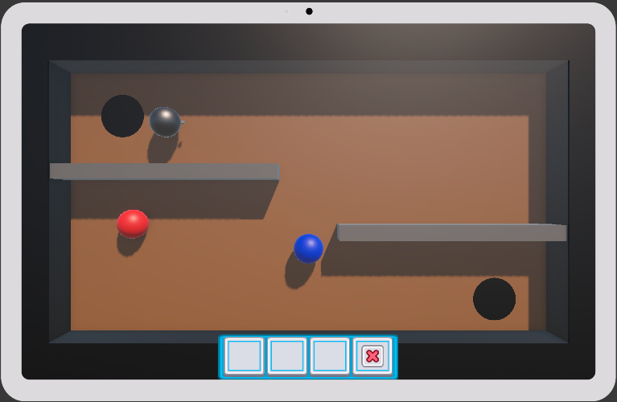
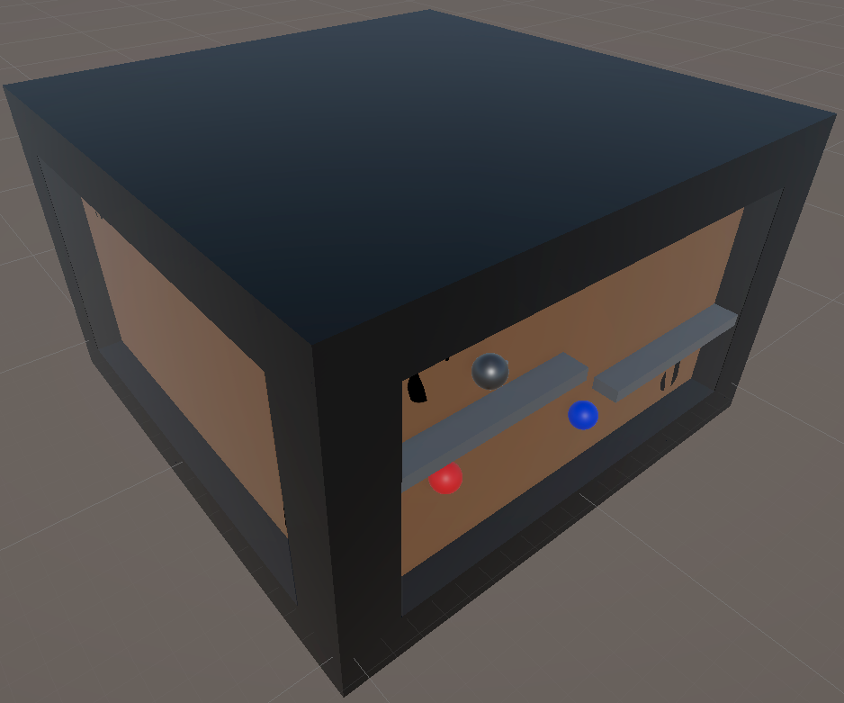

# Game Design Document

Game name:  (WIP) Magnetize Marble

By:     Stefan Vacik & Christian Redl

Student Course: GAME

---

## Core Concept
The core concept of the game is a digital physics-puzzle minigame acting as the "master lock" for a physical escape room. Players must use the principles of magnetism—placing and tuning positive and negative magnets—to guide a marble across the four faces of a giant digital glass cube. Completing all four sides calibrates the machine and unlocks the real-world escape room door.

---

## Main Features

### Objective
* **Goal:** Safely route a marble past obstacles to an exit point by placing and adjusting the strength of push/pull magnets on the active face of the cube.
* **Victory Condition:** The game is completed when the marble physically collides with the "Goal" trigger zone on all four faces of the cube. Completing the final face triggers a signal that unlocks the physical escape room door.

### Gameplay Mechanics
* **Core Interaction:** Touchscreen drag-and-drop on an Android tablet or mounted touchscreen inside the escape room. Players drag 3D magnet icons from a 2D UI panel onto a 2D plane intersecting the 3D cube environment.
* **Player Actions:**
    * Selecting positive (Push) or negative (Pull) magnets from the UI inventory.
    * Dragging and placing magnets freely within the glass cube face's constraints.
    * Adjusting magnet strength by tapping a placed magnet to tune its power.
    * Dragging placed magnets into a "Trash/Remove" UI zone to delete them.
    * Pressing "Play/Test" to release the marble and simulate the physics.
* **Challenges:** * Understanding and predicting magnetic trajectories based on varying strengths.
    * Limited inventory of magnets.
    * Physical obstacles (walls, gaps) inside the digital cube.
    * *Face 0:* Tutorial (Basic Pull & Intro to Magnet Strength). 
    * *Face 1:* Complex Pull mechanics.
    * *Face 2:* Introduction to Push mechanics.
    * *Face 3:* Combination level requiring precise mixing of push/pull forces.
* **Sketches:** A vertical 3D glass cube dominates the center of the tablet screen. A Kenney UI toolbar sits at the bottom for inventory and controls. A trash can icon sits in the corner.
    
    

### Story Integration
* **Narrative Context:** The players are trapped inside an advanced physics laboratory. The digital cube represents the laboratory's prototype energy-routing module, which also controls the electronic lock to the main exit. They must "calibrate" the machine to escape.
* **Clues:** Physical whiteboards, scattered lab notes, and props elsewhere in the real-world escape room display magnetic field lines and inverse-square law formulas. These physical clues directly hint at how players need to tune the magnet strengths in the digital game.
* **Consequences:** * *Success:* The current face powers up, and the giant digital cube rotates 90 degrees with heavy mechanical sounds. Completing the final face triggers the physical escape room door to pop open.
    * *Failure:* The marble falls into a reset zone, prompting the player to rethink their placement and tune the magnet strengths.

### Physical or Digital Design
* **Set-Up:** A digital Android application running on a touchscreen device. The architecture utilizes a static camera observing a central "Giant Cube" (`[THE_GIANT_CUBE]`). It may require a network relay or Bluetooth module to communicate with the physical room's magnetic door lock upon completion.
* **Visual style:** Clean, Educational Sci-Fi. Polished glass, metallic marbles, and bright, distinct colors for polarity (e.g., bright red for push, bright blue for pull).
* **Moodboard:** Clinical laboratory aesthetics, tactile Kenney UI elements, glowing magnetic wave indicators, and satisfying mechanical cube rotations (reminiscent of a Rubik's Cube or a puzzle box).

### Difficulty and Accessibility
* **Skill Level:** Moderate. It relies on logic, physics intuition, and reading clues in the physical room, rather than twitch reflexes.
* **Hints System:** If players are stuck, they can activate an optional **Ghost Pathing** feature (perhaps unlocked via an escape room game master). This shows a dotted trajectory line of where the marble will travel based on current magnet placements and strengths.
* **Accessibility Considerations:** * *Visual:* Magnets are identified by color, clear symbols (+ / -), and distinct 3D model shapes (Colorblind-friendly).
    * *Motor:* No time limits. Drag-and-drop placement and tuning can be done entirely at the player's own pace.

### Technical Details
* **Technology Used:** Unity Engine, C# scripting, Kenney UI assets, Android touchscreen input. The game relies on `CubeManager` for 90-degree rotations, and mathematical boundaries (`Mathf.Clamp` / raycasting to planes) for interactions rather than heavy rigidbodies.
* **Integration with Escape Room:** This is the climactic puzzle. Upon the `GameManager` registering the final victory state, the Android device sends a webhook, network packet, or Bluetooth signal to a microcontroller (like an Arduino/Raspberry Pi) in the room to disengage the magnetic lock on the exit door.

### Production Details
* **Development Requirements:** Programming the rotating Cube architecture, UI snapshot system, drag-and-drop handlers, custom magnetic attraction scripts factoring in adjustable strength, and the Ghost Pathing prediction logic.
* **Testing and Iteration:** High priority on playtesting with students to ensure the strength-adjustment UI feels intuitive, and that the "handshake" between the digital game winning and the physical door unlocking is 100% reliable.

---

## Target Audience
* **Target Audience Description:** AHS (Allgemeinbildende Höhere Schule) students participating in an educational escape room. The game is designed to engage teenagers, using gamification to practically demonstrate magnetic fields and force magnitudes under the thrilling context of "escaping."
* **MDA Framework:**
    * **Mechanics:** Drag-and-drop placement, coordinate clamping, adjustable force variables (magnet strength), physics-based velocity manipulation, dynamic trajectory projection.
    * **Dynamics:** Trial-and-error experimentation, translating real-world clues into digital solutions, and collaborative puzzle-solving (students discussing where to place magnets on the screen).
    * **Aesthetics:** * *Challenge:* The core appeal of solving a spatial physics puzzle under the context of an escape room.
        * *Discovery:* Learning how varying distances and manually adjusting magnet strength exponentially changes the magnetic pull.
        * *Submission/Sensation:* The satisfying click and mechanical rotation of the digital cube, culminating in the real-world thrill of the escape room door unlocking.
